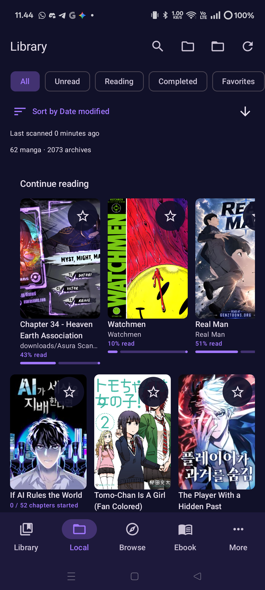
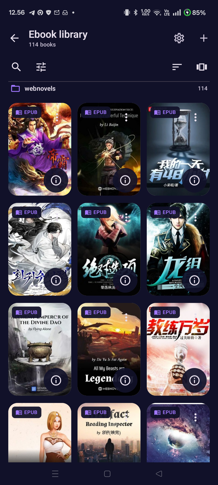
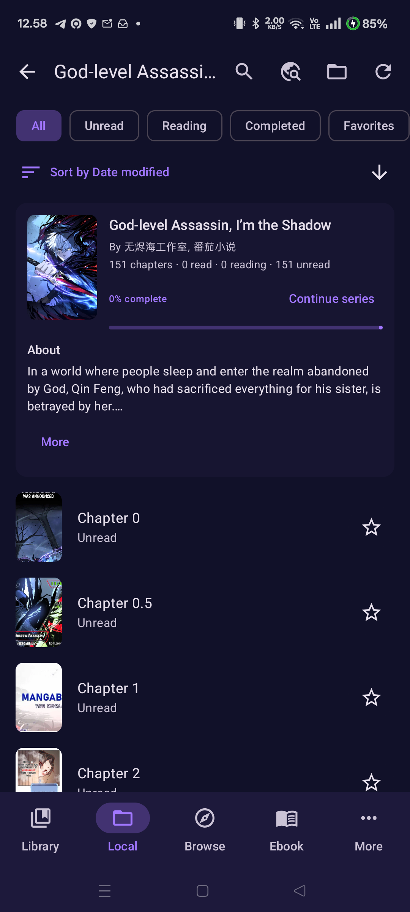

<h1><a href="https://github.com/wongpinter/komiyomi-ext">Komiyomi Ext</a></h1>

Browse manga from compatible source extensions, read local CBZ and CBR archives, and manage EPUB and PDF books on Android.

  <a href="https://github.com/wongpinter/komiyomi-ext/releases/latest">Download latest release</a> ·
  <a href="https://github.com/wongpinter/komiyomi-ext/releases">All releases</a> ·
  <a href="https://github.com/wongpinter/komiyomi-ext/issues">Issues</a>

Android 8.0 or newer

  
  
  

<a href="./docs/screenshots/README.md">See all current app screenshots</a>

## About

Komiyomi Ext is an independently maintained Android manga reader for compatible source extensions, local CBZ/CBR archives, EPUB/PDF books, downloads, trackers, and configurable readers. It has its own product identity, roadmap, releases, and services.

Komiyomi Ext is the extension-enabled app in the Komiyomi family. For a dedicated offline comic reader, see [Komiyomi](https://github.com/wongpinter/komiyomi).

## Features

- **Browse and discover manga:** Use compatible source extensions, search across sources, save searches, and explore feeds and recommendations.
- **Read online or offline:** Configure reading direction, viewer modes, and page loading; bookmark pages and navigate by chapter, section, or page. Smart Resume can continue to the next chapter after your chosen completion threshold, and separate Android tasks let you keep multiple readers open.
- **Manage a local manga library:** Scan a chosen folder and its subfolders for CBZ/CBR archives without moving them. Group multi-part files into series, track progress and favorites, and browse in grid or list views with search, filters, and sorting. From a local manga's detail screen, search installed extensions and apply a matching title, author, description, genres, status, and available cover. Saved metadata supplies the title and cover where available; the scanned cover and archive or folder name remain fallbacks.
- **Open large archives efficiently:** Komiyomi Ext caches archive indexes and loads pages as needed, which can make later opens of large CBZ files faster.
- **Read EPUB and PDF books:** Add files to the Ebook shelf or scan a selected folder. EPUB reading includes adjustable themes, fonts, text size, paged or scrolling layouts, table-of-contents navigation, bookmarks, and saved progress. The PDF reader supports contents navigation, text selection, bookmarks, and continuous or page-by-page layouts, with adjustable fit and color options. Ebook settings configure the shelf and reader defaults; screen-on behavior follows the app's reader preference.
- **Download chapters:** Download in the background, set concurrent download limits, or queue all chapters. Optionally save downloaded chapters as CBZ files.
- **Organize and back up your library:** Use categories, tags, saved searches, batch actions, source migration, and library/settings backups. Ebook backups preserve shelf and reader settings, reading positions, and bookmarks. Choose whether to include EPUB/PDF files; without the files, restore depends on the saved source locations remaining accessible.
- **Sync reading progress:** Connect trackers including AniList, Bangumi, Kitsu, Kavita, MangaDex, MangaUpdates, MyAnimeList, Shikimori, Suwayomi, and Komga.
- **Personalize the app:** Choose light, dark, or custom themes, including colors generated from a manga's cover.

Online source extensions are managed separately from this repository. Komiyomi Ext does not host or bundle manga content.

## Install

1. Download the latest Android APK from [Releases](https://github.com/wongpinter/komiyomi-ext/releases/latest).
2. Install it on a device running Android 8.0 or newer.
3. Open **Extensions** to add and manage compatible sources, use **Local** for your manga archives, or use **Ebook** for EPUB and PDF books.

## Set up a local CBZ/CBR library

1. Open **More → Settings → Data → Local manga folder**.
2. Choose the folder containing your CBZ or CBR files and grant access when Android asks.
3. Open the **Local** tab. Use **Rescan folder** after adding or changing files.

The selected folder may contain nested folders. Komiyomi Ext scans the archives where they are and does not move them. To save downloaded chapters as CBZ files under this folder, configure the option in **More → Settings → Downloads**.

## Match metadata for a local manga

1. Open a manga from **Local** to view its detail screen.
2. Choose **Search metadata from extensions**. The search starts with the manga title and searches your installed extensions.
3. Tap the matching result to apply its metadata and available cover to the local manga record.

The Local library uses the saved title and cover where available. If the extension has no usable cover, the scanned cover remains; the archive or folder name is the title fallback.

## Add EPUB and PDF books

Open **Ebook** to import EPUB or PDF files, or add a folder source to scan. Use **More → Settings → Ebook** to set the shelf layout and sorting, default EPUB appearance, PDF view options, and the shared keep-screen-on preference.

## Build from source

The project uses JDK 21 and the Android SDK. To build a debug APK:

~~~bash
./gradlew assembleDebug
~~~

For development setup and contribution guidelines, see [CONTRIBUTING.md](./CONTRIBUTING.md).

## Issues and contributing

Report bugs and request features through the [issue tracker](https://github.com/wongpinter/komiyomi-ext/issues). Before opening an issue, check the [release notes](https://github.com/wongpinter/komiyomi-ext/releases) and existing issues.

Contributions are welcome. Please read [CONTRIBUTING.md](./CONTRIBUTING.md) before opening a pull request, and follow the [Code of Conduct](./CODE_OF_CONDUCT.md).

## Project lineage and credits

Komiyomi Ext is a separate, independently maintained project. Its codebase includes work from [Komikku](https://github.com/komikku-app/komikku), [Mihon](https://github.com/mihonapp/mihon), and [TachiyomiSY](https://github.com/jobobby04/TachiyomiSY). These links record source history and contributor attribution; they do not imply affiliation, endorsement, or ongoing synchronization.

See the [Komikku contributor history](https://github.com/komikku-app/komikku/graphs/contributors), [Mihon contributors](https://github.com/mihonapp/mihon/graphs/contributors), and [TachiyomiSY contributors](https://github.com/jobobby04/TachiyomiSY/graphs/contributors). Additional credits are available in the app's **About** section.

## Disclaimer

Komiyomi Ext is not affiliated with content providers. The app hosts no manga or other content; users access sources and files they choose.

## License

Komiyomi Ext is licensed under the [Apache License 2.0](./LICENSE). See the license file for terms and copyright notices.
