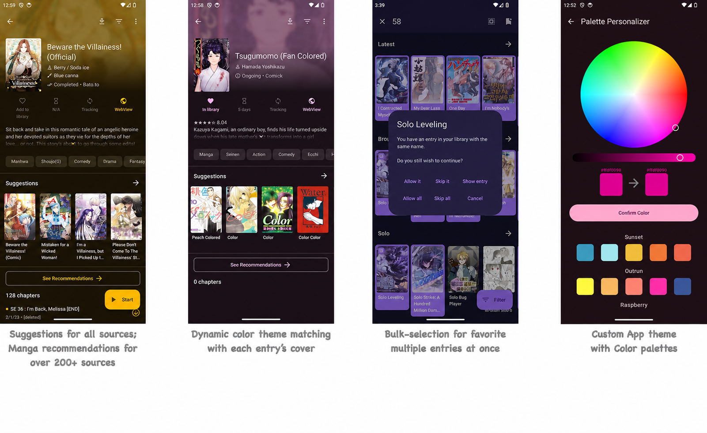

 
 <h1 align="center"> Komiyomi Ext </h1>

[Latest release](https://github.com/wongpinter/komiyomi-ext/releases/latest) · [All releases](https://github.com/wongpinter/komiyomi-ext/releases) · [Source](https://github.com/wongpinter/komiyomi-ext)

*Requires Android 8.0 or higher.*

Komiyomi Ext is an independent, open-source manga reader based on Komikku, Mihon, and TachiyomiSY. It is the extension-enabled companion to Komiyomi, the standalone CBZ/CBR reader. This fork adds features for online sources and offline reading while preserving attribution to its upstream projects.

## Features

### Komiyomi Ext features:
- Read manga from installable source extensions, with discovery, recommendations, saved searches, and multi-source browsing.
- Keep a local CBZ/CBR library beside your online sources. Choose an existing folder, scan its nested folders, and read archives in place; Komiyomi Ext does not move the files.
- Read large CBZ files page by page, with a cached archive index to speed up later opens.
- Track local archive progress and favorites, filter by reading status, sort the library, and switch between grid and list views.
- Navigate chapters and sections in an archive, jump to a page, and bookmark pages while reading.
- Download chapters in the background, set how many chapters can download at once, or queue every chapter of a manga.
- Optionally save downloaded chapters as CBZ files in the Local folder, grouped by manga and source.
- `Suggestions` automatically showing source-website's recommendations / suggestions / related to current entry for all sources.
- `Hidden categories` to hide yours things from *nosy* people.
- `Auto theme color` based on each entry's cover for entry View & Reader.
- `App custom theme` with `Color palettes` for endless color lover.
- `Bulk-favorite` multiple entries all at once.
- Source & Language icon on Library & various places. (Some language flags are not really accurate)
- `Feed` now supports **all** sources, with more items (20 for now).
- Fast browsing (for who with large library experiencing slow loading)
- Grouped entries in Update tab (inspired by J2K).
- Update notification with manga cover.
- Auto `2-way sync` progress with trackers.
- Chips for `Saved search` in source browse
- `Panorama cover` showing wide cover in full.
- `Merge multiple` library entries together at same time.
- `Range-selection` for Migration.
- Ability to `enable/disable repo`, with icon.
- `Update Error` screen & migrating them away.
- `to-be-updated` screen: which entries are going to be checked with smart-update?
- `Search for sources` & Quick NSFW sources filter in Extensions, Browse & Migration screen.
- `Feed` backup/restore/sync/re-order.
- Long-click to add/remove single entry to/from library, everywhere.
- Docking Read/Resume button to left/right.
- In-app progress banner shows Library syncing / Backup restoring / Library updating progress.
- Auto-install app update.
- Configurable interval to refresh entries from downloaded storage.
- Includes features from Mihon and TachiyomiSY, with compatible upstream updates brought in over time.
- More app themes & better UI, improvements...

### Set up a local CBZ/CBR library

1. Open **More → Settings → Data → Local manga folder**.
2. Choose the folder that contains your CBZ or CBR files and grant access when Android asks.
3. Open the **Local** tab in the bottom navigation. Use **Rescan folder** after adding or changing files.

The selected folder can contain nested folders. Archives stay where they are; the Local tab indexes their names and file details, then loads pages when you open an archive. Downloaded chapters can also be saved as CBZ files under the configured Local folder from **More → Settings → Downloads**.

  
Features from Mihon / Tachiyomi

#### All up-to-date features from Mihon / Tachiyomi (original), include:

* Online reading from a variety of sources
* Local reading of downloaded content
* A configurable reader with multiple viewers, reading directions and other settings.
* Tracker support: [MyAnimeList](https://myanimelist.net/), [AniList](https://anilist.co/), [Kitsu](https://kitsu.app/), [MangaUpdates](https://mangaupdates.com), [Shikimori](https://shikimori.one), [Bangumi](https://bgm.tv/)
* Categories to organize your library
* Light and dark themes
* Schedule updating your library for new chapters
* Create backups locally to read offline or to your desired cloud service
* Continue reading button in library

  
Features from Tachiyomi SY

#### All features from TachiyomiSY:
* Feed tab, where you can easily view the latest entries or saved search from multiple sources at same time.
* Automatic webtoon detection, allowing the reader to switch to webtoon mode automatically when viewing one
* Manga recommendations, uses MAL and Anilist, as well as Neko Similar Manga for Mangadex manga (Thanks to Az, She11Shocked, Carlos, and Goldbattle)
* Lewd filter, hide the lewd manga in your library when you want to
* Tracking filter, filter your tracked manga so you can see them or see non-tracked manga, made by She11Shocked
* Search tracking status in library, made by She11Shocked
* Custom categories for sources, liked the pinned sources, but you can make your own versions and put any sources in them
* Manga info edit
* Manga Cover view + share and save
* Dynamic Categories, view the library in multiple ways
* Smart background for reading modes like LTR or Vertical, changes the background based on the page color
* Force disable webtoon zoom
* Hentai features enable/disable, in advanced settings
* Quick clean titles
* Source migration, migrate all your manga from one source to another
* Saving searches
* Autoscroll
* Page preload customization
* Customize image cache size
* Batch import of custom sources and featured extensions
* Advanced source settings page, searching, enable/disable all
* Click tag for local search, long click tag for global search
* Merge multiple of the same manga from different sources
* Drag and drop library sorting
* Library search engine, includes exclude, quotes as absolute, and a bunch of other ways to search
* New E-Hentai/ExHentai features, such as language settings and watched list settings
* Enhanced views for internal and integrated sources
* Enhanced usability for internal and delegated sources

Custom sources:
* E-Hentai/ExHentai

Additional features for some extensions, features include custom description, opening in app, batch add to library, and a bunch of other things based on the source:
* 8Muses (EroMuse)
* Mangadex
* NHentai
* Puruin
* LANraragi

## Issues, Feature Requests and Contributing

Pull requests are welcome. For major changes, please open an issue first to discuss what you would like to change.

Issues

[Project repository](https://github.com/wongpinter/komiyomi-ext)

1. **Before reporting a new issue, check the [release notes](https://github.com/wongpinter/komiyomi-ext/releases) and [open issues](https://github.com/wongpinter/komiyomi-ext/issues).**
2. For questions, use the [Komiyomi Ext issue tracker](https://github.com/wongpinter/komiyomi-ext/issues).

Bugs

* Include version (More → About → Version)
 * If not latest, try updating, it may have already been solved
 * Preview version is equal to the number of commits as seen on the main page
* Include steps to reproduce (if not obvious from description)
* Include screenshot (if needed)
* If it could be device-dependent, try reproducing on another device (if possible)
* Don't group unrelated requests into one issue

Use the [issue forms](https://github.com/wongpinter/komiyomi-ext/issues/new/choose) to submit a bug.

Feature Requests

* Write a detailed issue, explaining what it should do or how.
* Include screenshot (if needed).

Contributing

See [CONTRIBUTING.md](./CONTRIBUTING.md).

Code of Conduct

See [CODE_OF_CONDUCT.md](./CODE_OF_CONDUCT.md).

### Upstream credits

Komiyomi Ext builds on the work of Komikku, Mihon, TachiyomiSY, and their contributors. Their names identify the upstream projects and do not imply affiliation.

See the [Komikku contributor history](https://github.com/komikku-app/komikku/graphs/contributors) and the upstream credits in the app's About section.

### Disclaimer

The developer(s) of this application does not have any affiliation with the content providers available, and this application hosts zero content.

## License

    Copyright 2015 Javier Tomás

    Licensed under the Apache License, Version 2.0 (the "License");
    you may not use this file except in compliance with the License.
    You may obtain a copy of the License at

    http://www.apache.org/licenses/LICENSE-2.0

    Unless required by applicable law or agreed to in writing, software
    distributed under the License is distributed on an "AS IS" BASIS,
    WITHOUT WARRANTIES OR CONDITIONS OF ANY KIND, either express or implied.
    See the License for the specific language governing permissions and
    limitations under the License.
