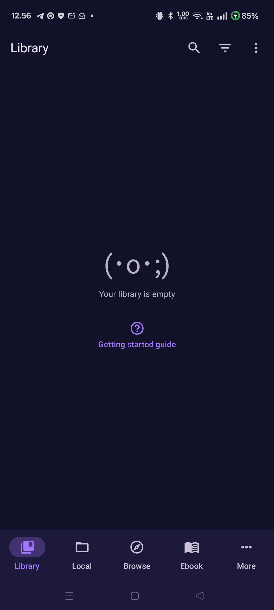
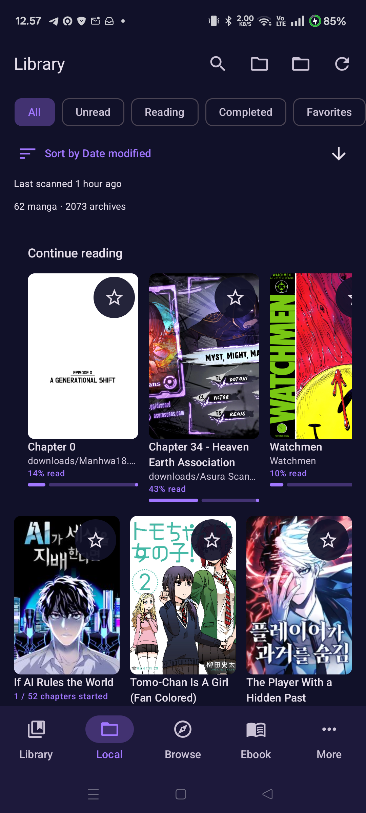
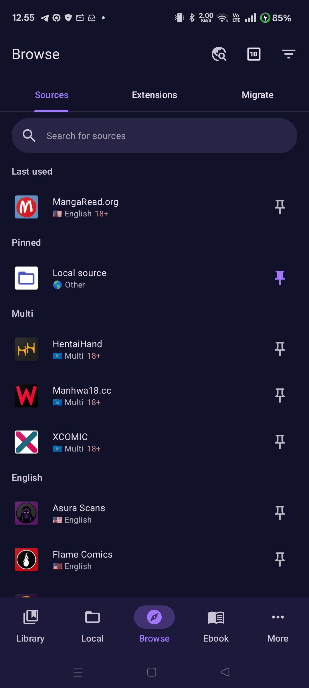
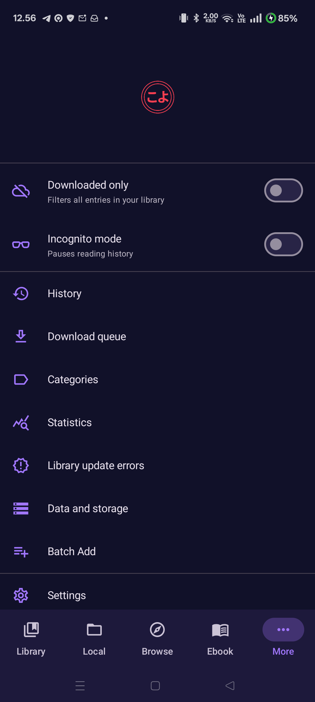
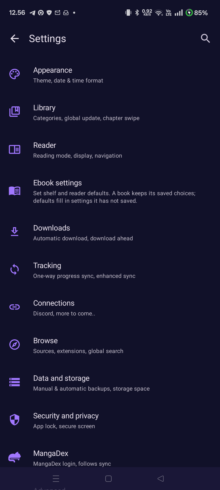
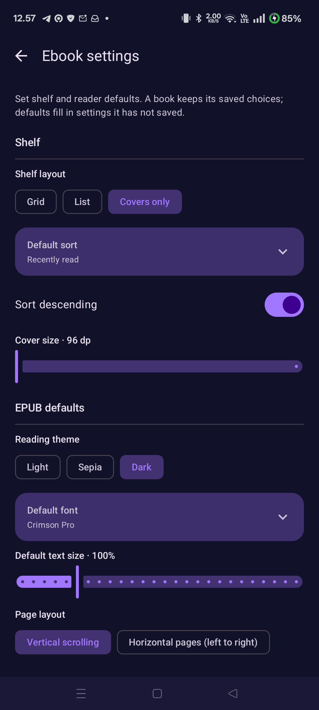
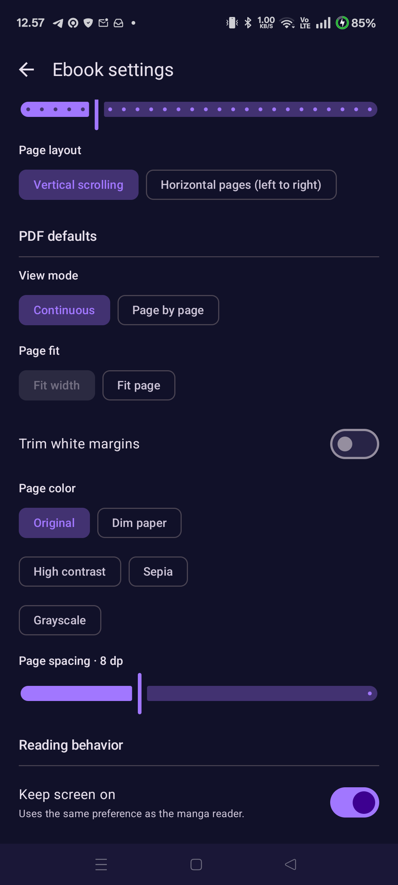
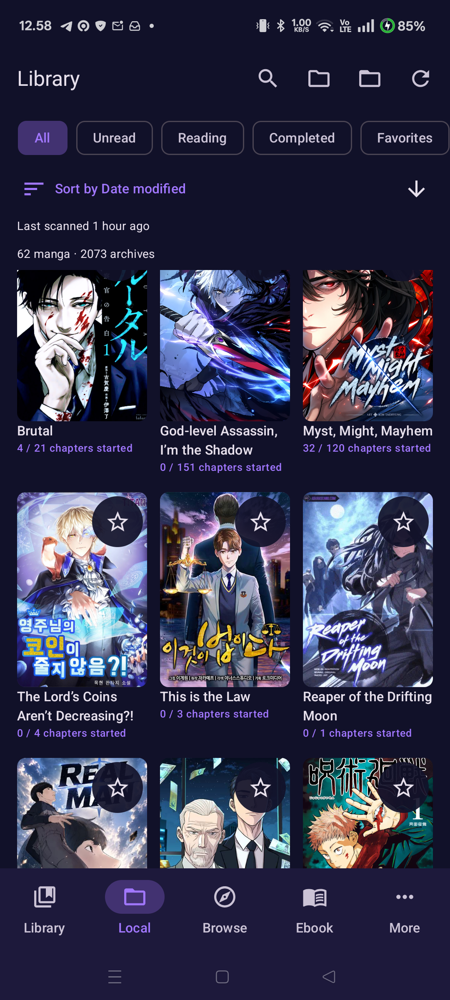

# Komiyomi Ext screenshots

Captured from the app running on a connected Android phone. These are representative main screens and feature views, not every dialog or reader state.

| Screen | Screenshot |
| --- | --- |
| Local library overview |  |
| Library empty state |  |
| Local library |  |
| Browse sources |  |
| Ebook shelf |  |
| More menu |  |
| Settings |  |
| Ebook settings: shelf and EPUB defaults |  |
| Ebook settings: PDF defaults |  |
| Local manga grid |  |
| Local manga detail |  |
